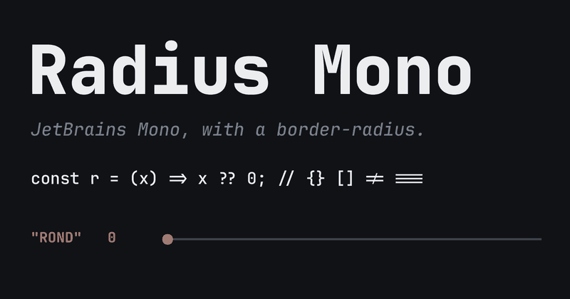

# Radius Mono



**JetBrains Mono, with a border-radius.**

[Website](https://kissuchaudhary.github.io/radius-mono/) · [Download](https://github.com/KissuChaudhary/radius-mono/releases/latest) · [Launch film](media/radius-mono-launch.mp4)

Radius Mono is an open-source coding font with a continuous **Roundness** axis. Slide `ROND` from `0` (JetBrains Mono's crisp corners) to `100` (fully rounded, as if drawn with a round pen) at any weight from Thin to ExtraBold, upright and italic. Metrics, spacing, ligatures and OpenType features are identical to JetBrains Mono, so switching never reflows your code.

## Highlights

- **Two continuous axes:** `ROND` 0–100 and `wght` 100–800, in one file per style.
- **Upright and Italic**, with 8 named weights each.
- **All 153 code ligatures and 35 OpenType features** (`cv01`–`cv20`, `ss01`, `ss02`, `ss19`, `ss20`, `zero`, …).
- **Joins stay seamless:** corners where ligature pieces meet the next character cell stay sharp, so `->`, `===`, `__init__` and `-->` connect exactly as before.
- **No notched junctions:** corners hidden inside overlapping strokes are detected and left alone.
- **ROND 0 is JetBrains Mono:** the largest deviation from the original outlines is 0.07% of the em, measured on every glyph.
- **1,743 glyphs, 1,363 characters:** Latin, Cyrillic and Greek, box drawing and powerline symbols (which must tile, so they stay sharp).

## Install

### Desktop (any app)

Download the [latest release](https://github.com/KissuChaudhary/radius-mono/releases/latest) and install the fonts from `ttf/`. The static fonts are fully rounded (`ROND 100`) in all 8 weights, upright and italic. Apps that support variable axes can use `variable/` instead and pick any roundness.

### VS Code

```json
{
  "editor.fontFamily": "Radius Mono",
  "editor.fontLigatures": true,
  "editor.fontVariations": "'ROND' 100, 'wght' 400"
}
```

Install the variable font for `editor.fontVariations` to take effect. Try `'ROND' 40` for a softer, subtler look.

### Ghostty

```
font-family = Radius Mono
font-variation = ROND=100
font-variation = wght=400
```

### Web

```css
@font-face {
  font-family: "Radius Mono";
  src: url("RadiusMono[ROND,wght].woff2") format("woff2");
  font-weight: 100 800;
  font-style: normal;
}
@font-face {
  font-family: "Radius Mono";
  src: url("RadiusMono-Italic[ROND,wght].woff2") format("woff2");
  font-weight: 100 800;
  font-style: italic;
}
code, pre {
  font-family: "Radius Mono", ui-monospace, monospace;
  font-variation-settings: "ROND" 100;
}
```

A ready-made stylesheet is in [`fonts/webfonts/radius-mono.css`](fonts/webfonts/radius-mono.css).

## Axes

| Axis | Tag | Range | Default | Notes |
|---|---|---|---|---|
| Roundness | `ROND` | 0–100 | 100 | 0 = JetBrains Mono outlines, 100 = fully rounded terminals |
| Weight | `wght` | 100–800 | 400 | Thin, ExtraLight, Light, Regular, Medium, SemiBold, Bold, ExtraBold |

## How it works

Radius Mono is generated from JetBrains Mono's variable fonts by [`scripts/roundify.py`](scripts/roundify.py), a general engine that adds a roundness axis to a TrueType variable font:

1. Every original master is reconstructed exactly from `glyf` + `gvar`.
2. Each visible corner gets a fillet in every master. Convex corners use a smooth, curvature-easing curve whose radius is half the stem width at `ROND 100`. Inner corners get a much smaller one. Fillets are converted to compatible quadratic splines across all masters.
3. Corners buried inside overlapping contours, corners at T-junctions, and corners on monospace cell boundaries are kept sharp. Fillets that would run into another stroke are shortened.
4. A sharp twin of each master with the identical point structure reproduces the original, and `gvar` is rebuilt for the new master set. The `ROND` axis is added to `fvar`, `avar`, `STAT` and every item variation store, so kerning, `HVAR` and named instances survive untouched.

## Build from source

Requires Python 3.10+.

```bash
python -m venv .venv
.venv/bin/pip install -r requirements.txt     # Windows: .venv\Scripts\pip
.venv/bin/python scripts/build.py             # downloads + verifies JetBrains Mono 2.304, builds everything
```

Outputs go to `fonts/variable`, `fonts/webfonts` and `fonts/ttf`. The upstream release is pinned by SHA-256.

### Website

The site in [`site/`](site/) is a Next.js app exported as static files and deployed to GitHub Pages by [`.github/workflows/pages.yml`](.github/workflows/pages.yml) on every push to `main`.

```bash
python tools/build_site.py      # copies fonts, film, poster, OG image and the download zip into site/
cd site && npm install && npm run dev
```

The launch film is rendered from the fonts with `python tools/video.py` (needs ffmpeg).

## Quality checks

- `tools/qa_outlines.py` compares every glyph against the source at each master: `ROND 0` must match JetBrains Mono, and `ROND 50`/`100` must not change any glyph's topology. Result for v1.000: no topology changes in the upright, and one benign change in the italic (`≇` ExtraBold, where rounding fills a pinched gap).
- [fontbakery](https://github.com/fonttools/fontbakery) `check-googlefonts`: no new failures compared with upstream JetBrains Mono 2.304, apart from two Google Fonts axis-registry checks. The registry's `ROND` entry expects a default of 0; Radius Mono defaults to 100 on purpose so that apps without axis support get the rounded design. Full report: [`qa/fontbakery.md`](qa/fontbakery.md).

## Roadmap

- Nerd Font patched builds
- `NL` builds without ligatures
- A matching proportional companion
- npm package with `@font-face` CSS

## License

The fonts are licensed under the [SIL Open Font License 1.1](OFL.txt). The build scripts and rounding engine in `scripts/` and `tools/` are MIT licensed ([LICENSE-CODE.txt](LICENSE-CODE.txt)).

Radius Mono is a modified version of [JetBrains Mono](https://github.com/JetBrains/JetBrainsMono) by Philipp Nurullin and Konstantin Bulenkov (© 2020 The JetBrains Mono Project Authors). It is an independent project, not affiliated with or endorsed by JetBrains. JetBrains Mono is a trademark of JetBrains s.r.o.
